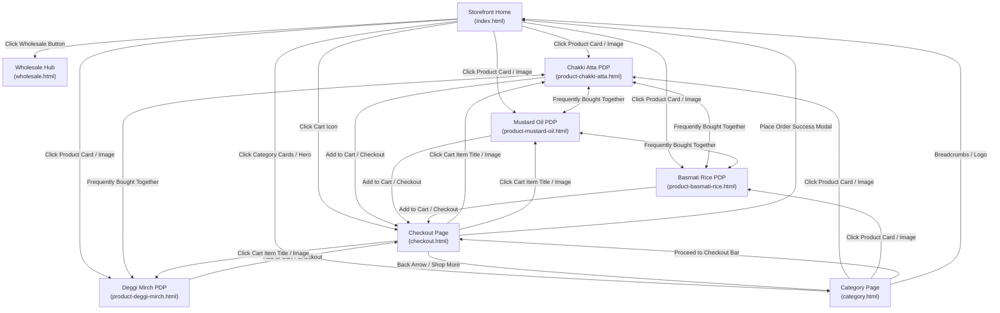

# JMD Cart — Quick Commerce & Bulk Wholesale Storefront

An integrated, multi-page quick commerce and bulk wholesale storefront with consistent design tokens, dedicated product pages, live cart synchronization, and connected UI flows.

---

## 📁 Clean Project Layout

Open this directory in any code editor (e.g. VS Code) or web browser. All duplicate files and unorganized folders have been cleaned up:

```text
├── index.html                  # 1. Main Home & Storefront (Entry Point)
├── category.html               # 2. Product Catalog & Category Page (Staples, Atta, Rice & Pulses)
├── checkout.html               # 3. Order Review & Checkout Page (Live bill & order confirmation)
├── wholesale.html              # 4. B2B Wholesale & Bulk Hub (Slab pricing & matrix order)
│
├── product-chakki-atta.html    # Dedicated PDP: Aashirvaad Shudh Chakki Atta (100% Whole Wheat)
├── product-mustard-oil.html    # Dedicated PDP: Fortune Kachi Ghani Pure Mustard Oil
├── product-basmati-rice.html   # Dedicated PDP: India Gate Feast Rozzana Basmati Rice
├── product-deggi-mirch.html    # Dedicated PDP: MDH Deggi Mirch Natural Red Pepper Powder
│
├── cart.js                     # Shared reactive cart manager, toast notifications & badge sync
├── DESIGN.md                   # Brand design tokens, color palette & typography
├── README.md                   # Project documentation & quick start guide
│
├── screenshots/                # Clean preview screenshots of all 8 storefront views
│   ├── 01-home-storefront.png
│   ├── 02-category-catalog.png
│   ├── 03-checkout-review.png
│   ├── 04-wholesale-hub.png
│   ├── 05-product-fortune-mustard-oil.png
│   ├── 06-product-india-gate-basmati-rice.png
│   ├── 07-product-mdh-deggi-mirch.png
│   └── 08-product-aashirvaad-chakki-atta.png
│
└── _backup_raw_sources.tar.gz  # Compressed archive of original raw unlinked source dumps
```

---

## 🔗 Integrated Cross-Page User Flow



---

## 💡 Key Features

1. **Clean One-Click Connections**:
   - Clicking any product title or image on Home or Category pages opens that product's dedicated page.
   - Clicking `ADD` adds the item to the cart without leaving the page, updates the header badge, and shows an instant checkout toast.
   - The floating bottom checkout bar (`🛒 3 Items in Cart • ₹1,648 | Proceed to Checkout →`) appears across catalog and product pages for quick navigation.
   - On the Checkout page, items link back to their dedicated product pages, quantity steppers recalculate totals live, and the "Place Order" button displays an order confirmation modal with return links.

2. **Cross-Selling**:
   - The "Frequently Bought Together" sections on each product page interlink with the other dedicated product pages.

3. **Consistent Theme**:
   - All pages use the exact same Tailwind tokens, Epilogue + Inter typography, Material Symbols Outlined icons, and header/footer layouts.

---

## 🚀 How to Run

Double-click `index.html` to open it in your browser, or run a local server:

```bash
# In this directory:
python3 -m http.server 8000
```
Then visit: **`http://localhost:8000/index.html`**
