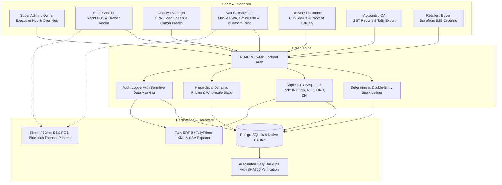
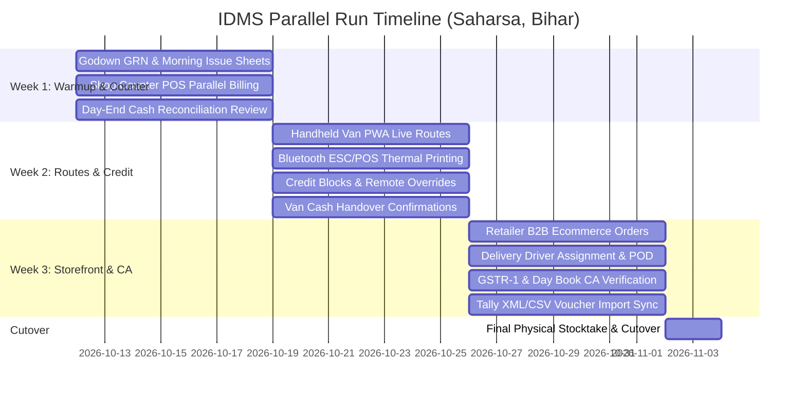

# IDMS Handover & Parallel Run Kickoff Protocol

**Project:** Integrated Distribution Management System (IDMS)  
**Client:** FMCG Super Distributor, Saharsa, Bihar  
**Target Delivery Date:** 15 November 2026  
**Status:** **READY FOR HANDOVER & PARALLEL RUN KICKOFF**  

---

## 1. Executive Handover Summary

The Integrated Distribution Management System (IDMS) has completed full engineering development across all 4 planned phases ahead of the 15 November 2026 delivery milestone. The software provides an end-to-end, local-first, FMCG distribution platform engineered specifically for local operational conditions in Saharsa, Bihar (intermittent rural cellular connectivity, dust-resilient thermal printing, carton-to-piece conversions, strict credit limit enforcement, and GST compliance).

### 1.1 Verification & Quality Metrics

| Audit Category | Specification / Standard | Current Status |
|---|---|---|
| **Automated Tests** | 48 test suites across unit & integration flows | **281 / 281 passing (100%)** |
| **End-to-End Tests** | Playwright Chromium browser tests across 7 roles | **8 / 8 passing (100%)** |
| **Type Integrity** | TypeScript strict mode (`tsc --noEmit`) | **0 errors** |
| **Code Quality** | ESLint (`next lint --dir src`) | **0 warnings / 0 errors** |
| **Production Build** | Next.js 14 standalone container build | **43 / 43 routes compiled** |
| **Database Ledger** | Immutable triggers on `stock_movements`, non-negative `stock_balances` | **Verified & active** |
| **Financial Arithmetic** | Strict integer paise (`*_paise`) across all models | **100% compliant** |
| **Backup & Restore** | SHA256 checksum verified dump & restore test (`pnpm db:validate-backup`) | **100% match across 29 tables** |

---

## 2. Operational System Architecture

---

## 3. Parallel Run Protocol (2 to 3 Weeks)

To ensure zero risk to daily cash flow and supplier obligations, the client will operate IDMS in parallel with their existing physical bill books and Tally ERP system for 2 to 3 weeks before formal primary cutover.

### 3.1 Parallel Run Schedule

### 3.2 Phase Breakdown

#### Week 1: Warmup, Shop Counter & Godown Calibration
* **Objective:** Verify catalog pricing, carton-to-piece conversions, and POS speed.
* **Daily Tasks:**
  1. Record supplier inwards via **Godown > Purchases (GRN)** upon truck arrival.
  2. Perform morning van load dispatches via **Godown > Van Issues**; print formal sign-off load sheets.
  3. Cashier bills counter walk-ins in IDMS (`/shop/pos`) while writing physical bill book copy.
  4. Compare evening drawer total on `/admin/reports?tab=cash` against physical cash drawer denomination count.
  5. Evening 15-minute alignment check with Owner.

#### Week 2: Van Mobile Operations, Credit Hard Stops & Handover
* **Objective:** Test route billing in low-signal rural zones (Simri Bakhtiarpur, Mahishi, Sonbarsa).
* **Daily Tasks:**
  1. Van salesperson logs into Android PWA (`/van`) on phone.
  2. Pairs 58mm/80mm Bluetooth printer via Web Bluetooth pairing modal.
  3. Issues bills on route; tests offline draft saving when cellular signal drops.
  4. Tests credit limit breach hard stop: attempts sale to over-limit retailer, triggers Super Admin PIN override.
  5. Issues on-route collection receipts (`REC/26-27/XXXXXX`) for debtor payments.
  6. Returns to godown at 6:30 PM: godown verifies unsold physical stock, Owner executes two-stage **Confirm Cash Handover** with variance sign-off.

#### Week 3: B2B Ecommerce, Delivery Runs & CA Alignment
* **Objective:** Verify retailer online ordering and monthly GST / accounting reconciliation.
* **Daily Tasks:**
  1. Selected trusted retailers sign up via `/register` (verified by Admin phone call).
  2. Retailers place wholesale orders via `/store`; check automated wholesale slab discount calculations.
  3. Admin reviews order at `/admin/orders`, prints **Split Pick List** (Godown full cartons vs Shop loose pieces), generates gapless Tax Invoice, and assigns delivery driver.
  4. Delivery driver executes run using `/delivery` mobile screen and records cash/UPI collection.
  5. External CA exports **GSTR-1 Table 4A (B2B)**, **Table 7 (B2CS)**, and **Table 12 (HSN Summary)** CSVs and compares with GST portal returns.
  6. Accounts exports **TallyPrime XML/CSV** vouchers from `/admin/reports?tab=tally` and imports into test Tally company to verify complete balance synchronization.

---

## 4. Daily Parallel Run Discrepancy Protocol

If any difference is observed between physical books/Tally and IDMS during the 3-week parallel run:

| Discrepancy Category | Root Cause Analysis | Action Plan |
|---|---|---|
| **Inventory Count Variance** | Loose carton breaks unrecorded or breakage not logged in `/godown/operations`. | Log damage or carton break immediately. Immutability prevents silent back-dating. |
| **GST / Invoice Paise Rounding** | Tally rounding vs GST standard half-up rounding. | IDMS extracts GST strictly from inclusive MRP using integer paise. Provide CA with Table 12 HSN export. |
| **Cash Drawer Mismatch** | Unrecorded van expense or unentered counter credit sale. | Check `/admin/reports?tab=cash` audit trail. Every payment mode is split and tracked. |
| **Credit Balance Difference** | Cheque in transit or manual adjustment in Tally. | Run Party Ledger Statement (`/admin/parties/[id]/ledger`) to match invoice-by-invoice debits and credits. |

---

## 5. Final Cutover Checklist (Going 100% Primary Live)

Once the 3-week parallel run concludes with 0 unresolved financial discrepancies:

1. [ ] **Freeze Physical Operations:** Conclude all sales and collections at 8:00 PM on cutover eve.
2. [ ] **Full Physical Stocktake:** Perform 100% physical count across Godown, Shop counter, and all vehicles using **Godown > Stock Audit** (`/godown/operations?tab=audit`).
3. [ ] **Approve Variances:** Super Admin reviews and approves stock audit to align system inventory.
4. [ ] **Tally Ledger Snapshot:** Export latest party balance list from Tally and execute final idempotent import via `/admin/parties/import`.
5. [ ] **Database Pre-Live Backup:** Run `pnpm db:validate-backup` to produce a signed SHA256 verified snapshot.
6. [ ] **Reset Sequences (If required for fresh start):** Re-verify sequence counters start cleanly for production financial series.
7. [ ] **Official Live Declaration:** Decommission carbon bill books for counter and van sales. IDMS is now the single source of truth!

---

## 6. Post-Delivery Warranty & AMC Terms

* **30-Day Operational Warranty:**
  * Free bug fixes, configuration adjustments, and user guidance for 30 calendar days following primary live cutover (or 21 days following initial software handover).
  * Priority 1 issues (invoicing halted, database lock, data mismatch): Under 4-hour response & hotfix.
  * Priority 2 issues (UI glitch, reporting filter question): Under 24-hour response.
* **Annual Maintenance Contract (AMC):**
  * Commences immediately upon warranty conclusion.
  * Covers automated daily backup monitoring, server updates, annual GST rate/HSN revisions, and telephone support.
* **Future Upgrade Options (Contract Phase 5):**
  * District-wide logistics expansion (Supaul, Madhepura routes).
  * Batch number and expiry date tracking.
  * Razorpay / UPI payment gateway live activation.
  * Automated WhatsApp PDF invoice delivery.

---

*Handover Prepared by:* **Integrated Distribution Management System Engineering Team**  
*Accepted and Initiated by:* **Super Admin / Business Owner (Saharsa, Bihar)**  
*Date:* **10 October 2026 (Ready for 15 Nov Milestone)**
